# Brain Tumor MRI Classifier

**A complete deep-learning project (PyTorch) that sorts a brain MRI slice into four classes and shows which part of the image the network looked at.**

| | |
|---|---|
| **Classes** | Glioma, Meningioma, Pituitary tumor, No tumor |
| **Models** | ResNet-18, ResNet-50, EfficientNet-B0, or a small custom CNN |
| **Explainability** | Grad-CAM heat-maps |
| **Interfaces** | Command line, a website with an upload box, or a Gradio demo |
| **Runs on** | CPU, NVIDIA GPU (CUDA) or Apple GPU (MPS) |
| **Dataset** | Brain Tumor MRI Dataset (Kaggle), about 7,000 images |

> **Medical disclaimer.** This is an educational and research project. It is **not** a medical device and must **never** be used to diagnose, rule out or make decisions about any medical condition. Always rely on a qualified radiologist or physician.

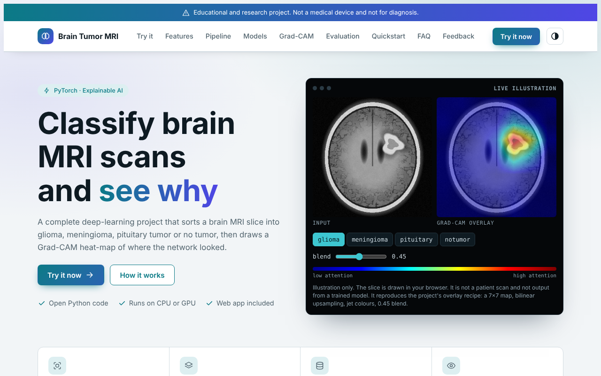

---

## Table of contents

1. [What this project does](#1-what-this-project-does)
2. [How it works](#2-how-it-works)
3. [Project structure](#3-project-structure)
4. [The dataset](#4-the-dataset)
5. [Installation](#5-installation)
6. [Quick start](#6-quick-start)
7. [Training in detail](#7-training-in-detail)
8. [Output files](#8-output-files)
9. [Evaluating and reading the results](#9-evaluating-and-reading-the-results)
10. [Predicting on your own images](#10-predicting-on-your-own-images)
11. [The website](#11-the-website)
12. [The four models](#12-the-four-models)
13. [Grad-CAM explained](#13-grad-cam-explained)
14. [Hardware, time and Google Colab](#14-hardware-time-and-google-colab)
15. [Limitations and honest expectations](#15-limitations-and-honest-expectations)
16. [Ideas for improving the model](#16-ideas-for-improving-the-model)
17. [Troubleshooting](#17-troubleshooting)
18. [Using the project again on another day](#18-using-the-project-again-on-another-day)
19. [Credits, references and license](#19-credits-references-and-license)

---

## 1. What this project does

You give it a brain MRI picture (JPG or PNG). It returns:

- **The predicted class**: glioma, meningioma, pituitary tumor, or no tumor.
- **A probability for every class**, so you can see how sure the model is.
- **A tumor probability**: the chance that the slice shows *any* tumor (1 minus the "no tumor" probability).
- **A Grad-CAM heat-map**: a coloured overlay showing which regions influenced the decision.

It also contains everything needed to *build* that model yourself: data loading and splitting, augmentation, a training script with a proper recipe, an evaluation script with confusion matrix and ROC curves, and a website to try it out.

### Website screenshots

The upload box on the website (**Try it**) returns the class probabilities, the tumor probability and the Grad-CAM overlay:

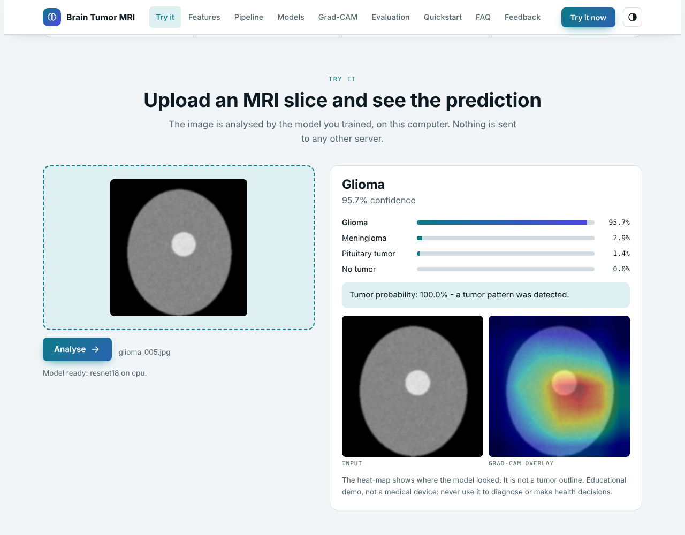

> The screenshot above was taken with a small model trained on **synthetic cartoon images** (see [section 8](#example-outputs-from-the-test-run)). The grey ellipse is not a real scan. Your results come from the model you train on real data.

<details>
<summary><b>More screenshots</b> (pipeline, Grad-CAM, evaluation, quick start, feedback, phone in dark mode)</summary>

| | |
|---|---|
| 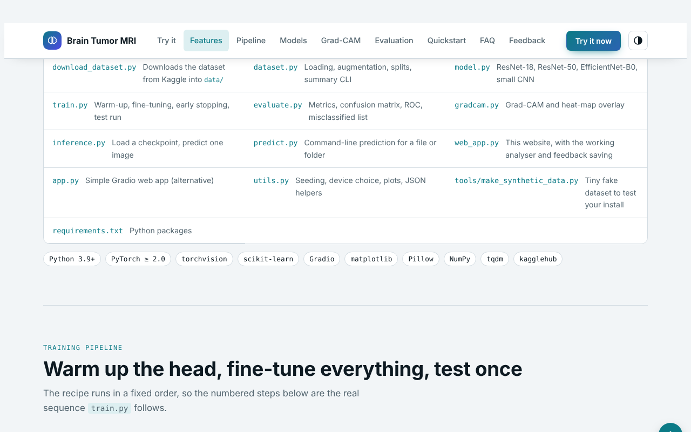 | 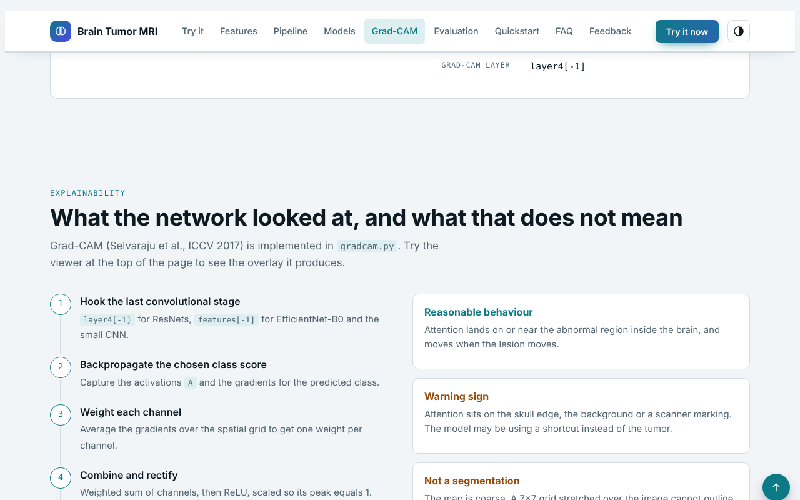 |
| 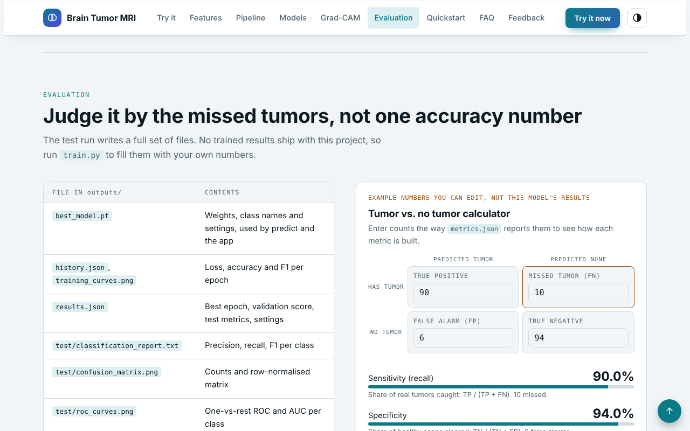 | 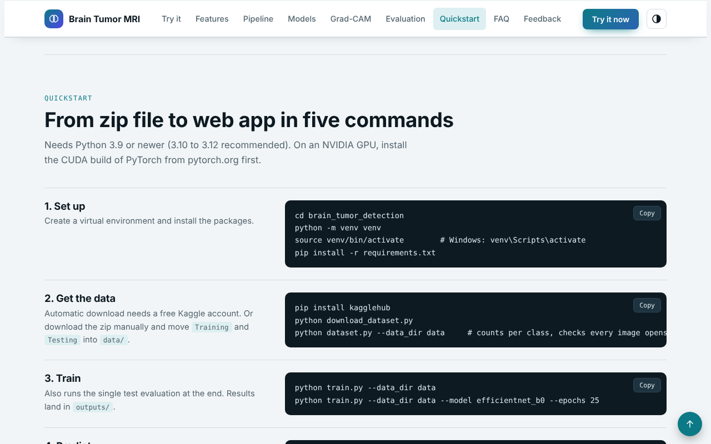 |
| 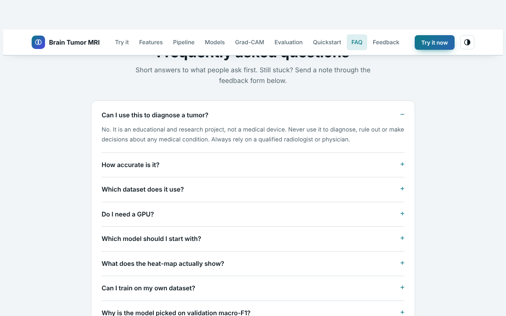 | 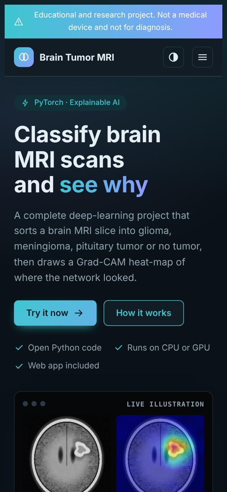 |

The hero image on the home page ("Live illustration") is drawn in your browser to explain the idea. It is not a patient scan and not output from a trained model.

</details>

---

## 2. How it works

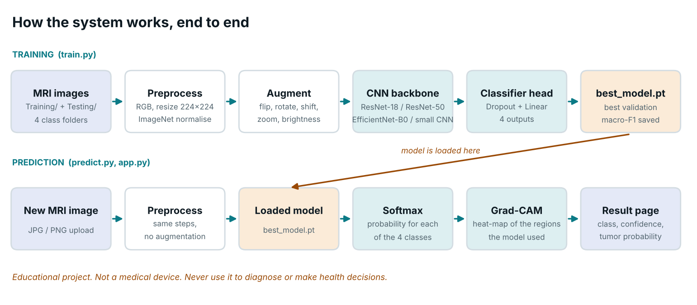

**Training** (`train.py`): MRI images are loaded, converted to 3 channels, resized to 224x224 and normalised. Training images are randomly augmented. A convolutional neural network (CNN) learns to map each image to one of the four classes. The best version (highest validation macro-F1) is saved as `outputs/best_model.pt`.

**Prediction** (`predict.py`, website): a new image goes through the same preprocessing (without augmentation) and the saved model. A softmax turns the network's four scores into probabilities. Grad-CAM then explains the decision as a heat-map.

### The training recipe

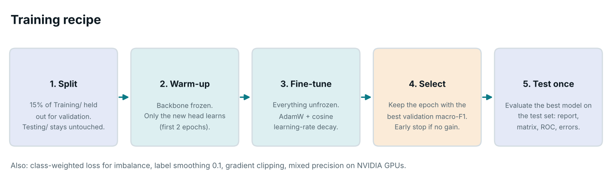

1. **Split.** 15% of the `Training/` folder is held out for validation. The `Testing/` folder is never touched until the very end.
2. **Warm-up.** With a pre-trained model, the backbone is frozen and only the new classification head is trained for the first 2 epochs.
3. **Fine-tune.** Everything is unfrozen and trained with AdamW and a cosine learning-rate schedule.
4. **Select.** The epoch with the best validation macro-F1 is kept. Training stops early if there is no improvement for 6 epochs.
5. **Test once.** The best model is evaluated a single time on the test set, which gives honest numbers.

Extras: class-weighted loss (for imbalanced classes), label smoothing of 0.1, gradient clipping, and mixed precision on NVIDIA GPUs.

---

## 3. Project structure

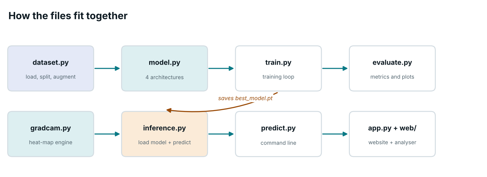

```
brain_tumor_detection/
├── README.md                 <- this file
├── requirements.txt          <- Python packages
├── download_dataset.py       <- downloads the dataset from Kaggle into ./data
├── dataset.py                <- loading, splitting, augmentation (also a dataset-summary command)
├── model.py                  <- ResNet-18 / ResNet-50 / EfficientNet-B0 / small CNN
├── train.py                  <- training, validation, early stopping, final test evaluation
├── evaluate.py               <- metrics, confusion matrix, ROC curves, list of mistakes
├── gradcam.py                <- Grad-CAM implementation (no extra packages)
├── inference.py              <- shared code: load a checkpoint, predict one image
├── predict.py                <- command-line prediction for one image or a folder
├── utils.py                  <- seeds, device choice, plotting helpers
├── app.py                    <- the website (Flask): web/index.html + analyser + feedback
├── web_app.py                <- the same website using FastAPI (alternative to app.py)
├── app_gradio.py             <- a simple Gradio demo (alternative)
├── web/
│   └── index.html            <- the website design
├── docs/images/              <- pictures used in this README
├── tools/
│   ├── make_synthetic_data.py  <- tiny FAKE dataset to test your installation
│   └── make_small_subset.py    <- shrink the dataset into a small zip (e.g. for uploads)
├── data/                     <- put the dataset here (Training/ and Testing/)
└── outputs/                  <- created by train.py (model, plots, metrics)
```

---

## 4. The dataset

**Brain Tumor MRI Dataset** by Masoud Nickparvar, on Kaggle:
**https://www.kaggle.com/datasets/masoudnickparvar/brain-tumor-mri-dataset**

- About 7,000 MRI images, roughly 5,700 for training and 1,300 for testing. The download is about 150 to 170 MB.
- Four classes: `glioma`, `meningioma`, `pituitary`, `notumor`.
- It combines several public brain-MRI collections. Read the Kaggle page for the sources and the **license/terms**, and follow them.
- Details such as the exact counts come from the dataset page. Check them there, since they can change.

### Required folder layout

```
data/
  Training/
    glioma/       *.jpg
    meningioma/   *.jpg
    notumor/      *.jpg
    pituitary/    *.jpg
  Testing/
    glioma/  meningioma/  notumor/  pituitary/
```

### How to get it

**Option A: automatic** (needs a free Kaggle account)

```bash
pip install kagglehub
python download_dataset.py
```
If Kaggle asks for credentials, create an API token at https://www.kaggle.com/settings and follow https://www.kaggle.com/docs/api (put `kaggle.json` in your `.kaggle` folder, or set the `KAGGLE_USERNAME` and `KAGGLE_KEY` environment variables).

**Option B: manual** (simplest)
1. Open the Kaggle link above, sign in (free), and click **Download**. You get a zip of about 167 MB.
2. Unzip it. You see two folders, **Training** and **Testing**.
3. Move both folders into this project's `data` folder.

### Check that it loaded correctly

```bash
python dataset.py --data_dir data
```
This prints the number of images per class for train / validation / test, the class weights used by the loss, and checks that every image opens.

### Making a small copy of the dataset

If you need to upload a smaller version (for example to a chat or a size-limited site), this script shrinks the images and builds a balanced zip:

```bash
python tools/make_small_subset.py --src path/to/unzipped_dataset --out small_subset.zip --max_mb 28
```

### Using a different dataset

Any folder with **one sub-folder per class** works, for example the two-class "Brain MRI Images for Brain Tumor Detection" dataset (`yes/` and `no/`). If there is no `Training/` + `Testing/` structure, the code makes a stratified 70 / 15 / 15 train / validation / test split automatically. The tumor-vs-no-tumor report and the tumor probability only appear when a class is named `notumor`.

---

## 5. Installation

You need **Python 3.9 or newer**. **Python 3.10, 3.11 or 3.12 is the safest choice.** Very new Python versions (for example 3.14) may not yet be supported by PyTorch. If `pip install -r requirements.txt` says `No matching distribution found for torch`, install Python 3.12 and use that.

### Windows (PowerShell)

```powershell
cd path\to\brain_tumor_detection
python -m venv venv
venv\Scripts\Activate.ps1
python -m pip install --upgrade pip
pip install -r requirements.txt
```
- If PowerShell says scripts are disabled, run `Set-ExecutionPolicy -Scope Process -ExecutionPolicy Bypass` and activate again. This only affects the current window.
- If `python` is not recognised, use `py` instead (for example `py -3.12 -m venv venv`).
- `source venv/bin/activate` is a Mac/Linux command and does not work in PowerShell.

### macOS / Linux

```bash
cd brain_tumor_detection
python3 -m venv venv
source venv/bin/activate
python -m pip install --upgrade pip
pip install -r requirements.txt
```

When the environment is active, your prompt starts with `(venv)`.

### NVIDIA GPU (optional, much faster)

Install the CUDA build of PyTorch with the selector at https://pytorch.org/get-started/locally/ **before** running `pip install -r requirements.txt`.

### Packages

`torch`, `torchvision` (models), `numpy`, `pillow` (images), `scikit-learn` (metrics), `matplotlib` (plots), `tqdm` (progress bars), `flask` (website), `fastapi` + `uvicorn` + `python-multipart` (alternative website), `gradio` (alternative demo), `kagglehub` (dataset download).

### Check your installation without the dataset

```bash
python tools/make_synthetic_data.py --out synthetic_data
python train.py --data_dir synthetic_data --output_dir outputs_test --model resnet18 --no_pretrained --epochs 3 --batch_size 16 --num_workers 0
```
This trains on cartoon images in a minute or two. It only proves the code runs. The results mean nothing medically. Delete `synthetic_data/` and `outputs_test/` afterwards.

---

## 6. Quick start

With the environment active and the dataset in `data/`:

```bash
python dataset.py --data_dir data                  # 1. sanity-check the data
python train.py --data_dir data                    # 2. train (also runs the test evaluation)
python predict.py --image path/to/some_mri.jpg     # 3. predict one image
python app.py                                      # 4. the website at http://127.0.0.1:7860
```

On Windows, add `--num_workers 0` to the training command if you see multiprocessing errors:

```powershell
python train.py --data_dir data --num_workers 0
```

For a quick first try, train for only 5 epochs: `python train.py --data_dir data --epochs 5`.

---

## 7. Training in detail

```bash
python train.py --data_dir data --model resnet18 --epochs 20
```

| Option | Default | Meaning |
|---|---|---|
| `--data_dir` | `data` | Folder with `Training/` and `Testing/` |
| `--output_dir` | `outputs` | Where results are written |
| `--model` | `resnet18` | `resnet18`, `resnet50`, `efficientnet_b0`, or `simple_cnn` |
| `--no_pretrained` | off | Train from random weights instead of ImageNet weights |
| `--img_size` | 224 | Input resolution |
| `--epochs` | 20 | Maximum epochs (early stopping may end sooner) |
| `--batch_size` | 32 | Lower to 16 or 8 if you run out of memory |
| `--lr` | 3e-4 (1e-3 for `simple_cnn`) | Learning rate while fine-tuning |
| `--head_lr` | 1e-3 | Learning rate during the warm-up |
| `--freeze_epochs` | 2 | Warm-up epochs with the backbone frozen |
| `--weight_decay` | 1e-4 | AdamW weight decay |
| `--label_smoothing` | 0.1 | Softens the training targets |
| `--dropout` | 0.3 | Dropout before the final layer |
| `--patience` | 6 | Early-stopping patience in epochs |
| `--val_split` | 0.15 | Share of `Training/` used for validation |
| `--test_split` | 0.15 | Only used if the dataset has no `Testing/` folder |
| `--num_workers` | min(4, CPUs) | Data-loading processes. Use `0` on Windows if you see errors |
| `--seed` | 42 | Makes runs repeatable |
| `--device` | `auto` | `auto`, `cpu`, `cuda`, or `mps` |
| `--no_amp` | off | Turn off mixed precision on CUDA |

Examples:

```bash
python train.py --data_dir data --model efficientnet_b0 --epochs 25
python train.py --data_dir data --model resnet50 --batch_size 16
python train.py --data_dir data --model simple_cnn --no_pretrained --epochs 40
```

While training, one line is printed per epoch:

```
Epoch 03/20 | train loss 0.41 acc 0.86 | val loss 0.35 acc 0.90 macro-F1 0.89 | lr 2.9e-04 | 142s
  -> new best model saved (val macro-F1 0.8900)
```

You want accuracy and macro-F1 to rise and the losses to fall. If training accuracy keeps rising while validation gets worse, the model is overfitting.

At the end, the best checkpoint is evaluated once on the test set and everything is saved to `outputs/`.

### Pre-trained versus from scratch

`resnet18`, `resnet50` and `efficientnet_b0` start from **ImageNet pre-trained weights**, which usually gives much better results with less data and time. The weights download automatically the first time you train, so you need internet access. Without it, the code prints a warning and trains from random weights. `simple_cnn` always trains from scratch.

---

## 8. Output files

Everything is saved in `outputs/` (or the folder you gave with `--output_dir`).

| File | What it contains |
|---|---|
| `best_model.pt` | Trained weights, class names and settings. Used by `predict.py` and the website |
| `history.json`, `training_curves.png` | Loss, accuracy and F1 for every epoch |
| `results.json` | Best epoch, validation score, full test metrics, all training settings |
| `test/classification_report.txt` | Precision, recall and F1 for each class |
| `test/confusion_matrix.png` | Counts and row-normalised confusion matrix |
| `test/roc_curves.png` | One-vs-rest ROC curve and AUC for each class |
| `test/metrics.json` | All metrics, including the binary tumor-vs-no-tumor sensitivity and specificity |
| `test/misclassified.csv` | Every wrongly classified test image, with the model's confidence |
| `predictions/` | Pictures made by `predict.py` (input and Grad-CAM overlay) |
| `feedback.jsonl` | Feedback submitted on the website (created by `app.py`) |

### Example outputs from the test run

> **Important.** The images in this section were produced by running the pipeline for 4 epochs on the **synthetic cartoon dataset** from `tools/make_synthetic_data.py` (48 test images). They show what the output files look like. They say **nothing** about how well the model works on real MRI scans. Your own files in `outputs/` come from real data.

**Training curves** (`training_curves.png`)

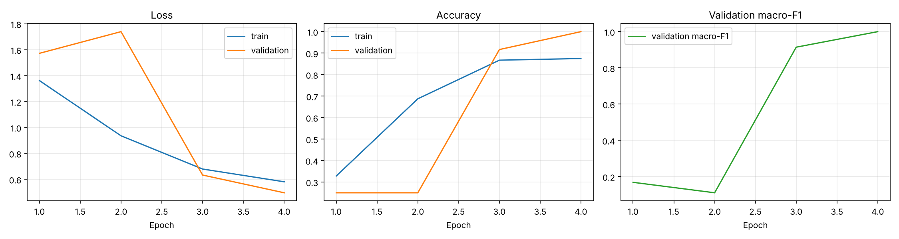

**Confusion matrix** (`test/confusion_matrix.png`): rows are the true class, columns the prediction. Numbers on the diagonal are correct. The off-diagonal numbers show which classes get confused.

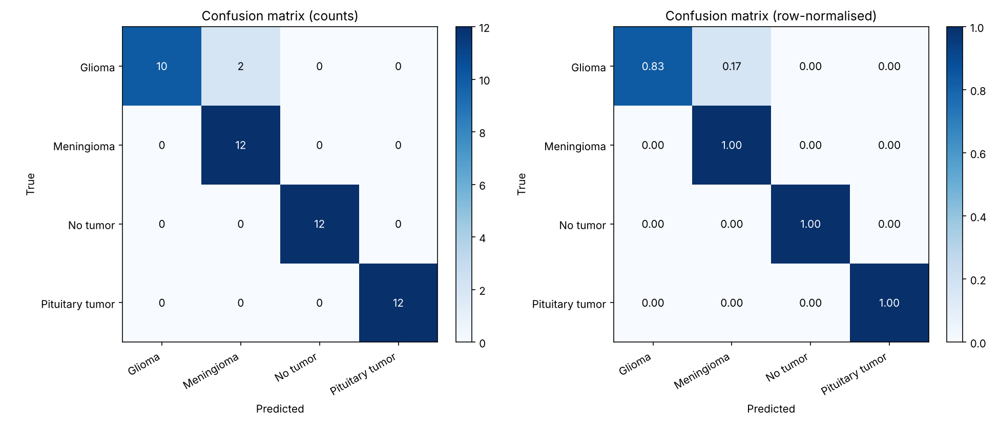

**ROC curves** (`test/roc_curves.png`)

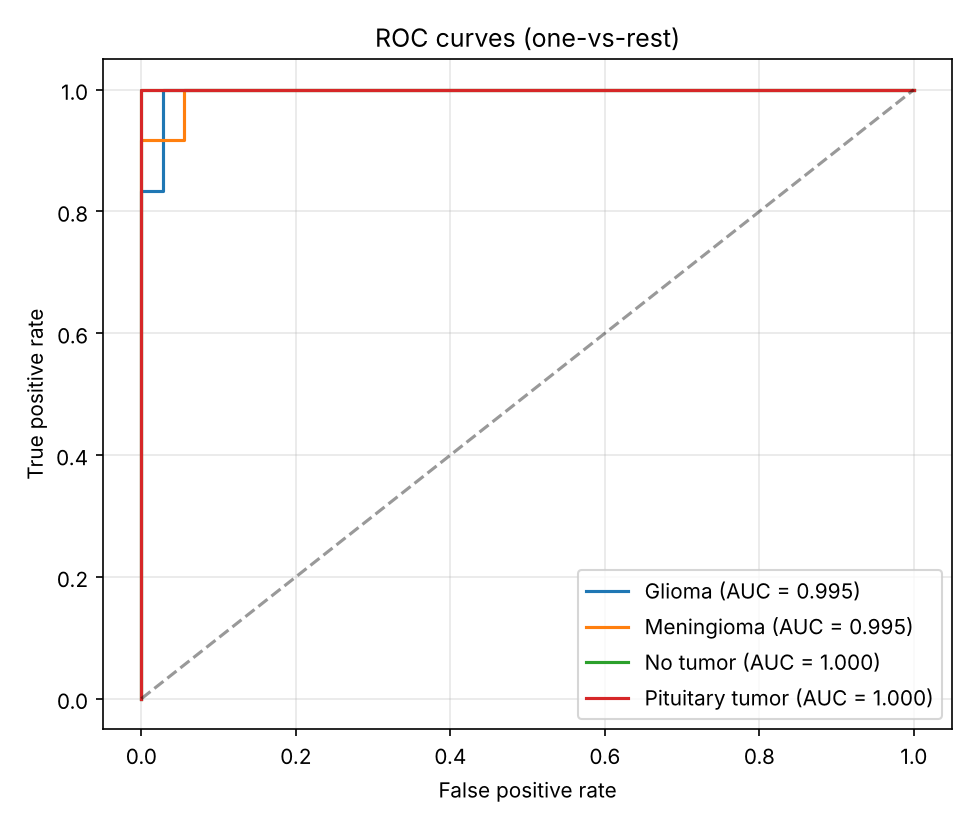

**Prediction picture** (`predictions/..._prediction.png`)

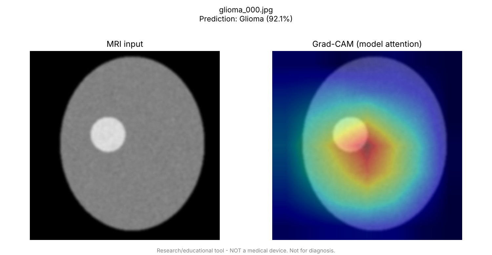

---

## 9. Evaluating and reading the results

The test evaluation runs automatically at the end of training. To run it again later:

```bash
python evaluate.py --data_dir data --checkpoint outputs/best_model.pt
```

### How to read the numbers

- **Accuracy**: the share of images classified correctly. Useful, but one number hides a lot.
- **Precision** (per class): when the model says "glioma", how often is it right?
- **Recall** (per class): of all real gliomas, how many did the model find?
- **F1**: a single score combining precision and recall. **Macro-F1** averages it over the classes equally, so a weak class cannot hide.
- **Confusion matrix**: shows exactly *which* classes get mixed up. Glioma versus meningioma is a common pair.
- **AUC (ROC)**: how well the model ranks images of a class above the others. 1.0 is perfect, 0.5 is guessing.
- **Sensitivity and specificity** (tumor versus no tumor): sensitivity is the share of real tumors caught, specificity the share of healthy slices correctly cleared. For a screening-style task, **missed tumors (false negatives)** matter most, so look at that count and not only at accuracy.

Open `test/misclassified.csv` to look at the pictures the model got wrong. Patterns there are the best clue for what to improve.

---

## 10. Predicting on your own images

```bash
python predict.py --image path/to/mri.jpg
python predict.py --image path/to/folder --save_dir outputs/predictions
python predict.py --image path/to/mri.jpg --no_cam      # skip the heat-map
```

| Option | Default | Meaning |
|---|---|---|
| `--image` | required | An image file or a folder of images |
| `--checkpoint` | `outputs/best_model.pt` | Which trained model to use |
| `--save_dir` | `outputs/predictions` | Where the result pictures are saved |
| `--no_cam` | off | Skip Grad-CAM |
| `--device` | `auto` | `auto`, `cpu`, `cuda`, `mps` |

It prints the probabilities for all classes and saves a picture with the input and the Grad-CAM overlay.

**Test on random images from the test set (Windows PowerShell):**

```powershell
$img = Get-ChildItem data\Testing -Recurse -Include *.jpg,*.jpeg,*.png | Get-Random
"True class: " + $img.Directory.Name
python predict.py --image $img.FullName
```
The folder name is the correct answer, so you can see whether the model guessed right.

**Images from other places** (the internet, other datasets) usually give worse results. Scans from other sources look different (cropping, contrast, view, text labels), and the model learned from one dataset only. Only use public images with no patient details.

---

## 11. The website

The project includes a website (`web/index.html`) with the full project description, a working **Try it** upload box, an interactive Grad-CAM illustration, a learning-rate explorer, a metrics calculator, an FAQ, and a feedback form.

```bash
python app.py
```
It opens **http://127.0.0.1:7860** in your browser automatically. Go to **Try it**, drop in an MRI image and click **Analyse**.

Start-up takes 10 to 30 seconds because PyTorch loads first. The site opens even if you have not trained a model yet. The Try-it box then tells you to run `train.py`. After retraining, stop the site with Ctrl+C and start it again so it loads the new model.

### Three ways to serve it

| Command | Technology | Default address | Notes |
|---|---|---|---|
| `python app.py` | Flask | http://127.0.0.1:7860 | **Recommended.** Opens the browser. Feedback in `outputs/feedback.jsonl`. Upload limit 15 MB |
| `python web_app.py` | FastAPI + uvicorn | http://127.0.0.1:8000 | Same website. Feedback in `feedback/feedback.jsonl`. Upload limit 10 MB |
| `python app_gradio.py` | Gradio | http://127.0.0.1:7860 | Simpler page without the project description. `--share` makes a public link, so avoid it with real patient images |

Options for `app.py`: `--checkpoint`, `--device`, `--host`, `--port`, `--feedback_file`, `--no_browser`. Example: `python app.py --port 7861 --no_browser`.

### Privacy and safety

- The server listens on **127.0.0.1** by default, so only your own computer can reach it. Images are analysed locally and are not sent anywhere.
- Do not change `--host` to expose it on a network, and never use real patient images on a shared server.
- Feedback is saved in a text file on your computer. Only you can read it.

### HTTP API

| Route | Method | Purpose |
|---|---|---|
| `/` | GET | The website |
| `/api/status` | GET | Is a model loaded? Which classes and device? |
| `/api/predict` | POST | Upload an image (form field `image` for `app.py`, `file` for `web_app.py`). Returns class, probabilities, tumor probability, and the input and Grad-CAM images as PNG data URLs |
| `/api/feedback` | POST | JSON `{name, email, topic, rating, message}` appended to the feedback file |

The page sends both field names, so it works with either server.

### Opening the page without the server

Double-clicking `web/index.html` shows the design, but the analyser and the feedback form only work through `app.py` (or `web_app.py`). The page loads its fonts from Google Fonts, so it looks plainer without internet access.

---

## 12. The four models

| `--model` | Parameters | Pre-trained | Speed | When to use |
|---|---|---|---|---|
| `resnet18` | 11.2 M | ImageNet | fast | **Default.** Strong, light, good first choice |
| `resnet50` | 23.5 M | ImageNet | slower | A bit more capacity. Needs more memory |
| `efficientnet_b0` | 4.0 M | ImageNet | medium | Accurate and compact |
| `simple_cnn` | 1.2 M | no | fast | Learning and comparison. Four conv blocks trained from scratch |

(Parameter counts are for the 4-class versions in this project.) All pre-trained models get a new classification head: dropout followed by a linear layer with 4 outputs.

---

## 13. Grad-CAM explained

Grad-CAM (Selvaraju et al., 2017) answers the question *"which parts of the image made the network choose this class?"*

1. The image goes through the network. The last convolutional layer produces a small stack of feature maps (7x7 for a 224x224 input).
2. The gradient of the chosen class score with respect to those maps tells how important each map is.
3. The maps are combined using those importances, negative values are removed, and the result is scaled up to the image size and drawn in colour (blue = low attention, red = high attention) on top of the picture.

The implementation is in `gradcam.py` and uses no extra packages.

**Important:** the heat-map shows what the *model* looked at. It is **not** a tumor segmentation and not a precise tumor outline. If the model highlights the skull edge or the background, that is a warning that it may be using shortcuts instead of the tumor.

---

## 14. Hardware, time and Google Colab

| Setup | ResNet-18, about 5,700 training images, per epoch |
|---|---|
| Recent NVIDIA GPU | well under a minute |
| Laptop or desktop CPU | several minutes (budget roughly an hour for 10 to 15 epochs) |

These are rough estimates. Your time depends on the computer.

### No GPU? Use Google Colab (free)

1. Go to https://colab.research.google.com, create a notebook, and choose **Runtime, Change runtime type, T4 GPU**.
2. Upload the project zip with the folder icon on the left.
3. Run, in separate cells:

```python
!unzip -q brain_tumor_detection.zip
%cd brain_tumor_detection
!pip install -q kagglehub scikit-learn gradio flask
```
```python
import kagglehub
kagglehub.login()   # paste your Kaggle username and token
```
```python
!python download_dataset.py
!python dataset.py --data_dir data
!python train.py --data_dir data --model resnet18 --epochs 15
```
4. Download the trained model:
```python
from google.colab import files
files.download("outputs/best_model.pt")
```
5. Put `best_model.pt` into `outputs/` in your local project and run `python app.py` or `python predict.py`.

---

## 15. Limitations and honest expectations

- **No real-data results are included.** The code was tested end to end (training, evaluation, Grad-CAM, prediction, website, all four architectures) on synthetic cartoon images only. No accuracy claim is made for real MRI scans. Train on the real dataset and read your own `outputs/test/` files.
- **Expected range.** ImageNet-pre-trained CNNs commonly reach high test accuracy on this kind of dataset, but your numbers will vary with the model, seed and epochs. Trust the per-class table, the confusion matrix and the count of missed tumors more than one accuracy figure.
- **A good score on a public dataset is not clinical validity.** It does not mean the model works on scans from other hospitals, scanners, protocols or patient groups.
- **Dataset issues.** Public datasets can contain duplicate or near-duplicate images across the train and test folders, which inflates scores. Labels here are not clinically re-verified. Images are single 2D slices, not full 3D scans, and carry no clinical context.
- **Confidence is not certainty.** Softmax probabilities can be high and still wrong, especially on images unlike the training data.
- **Grad-CAM is an explanation aid**, not a diagnosis tool and not a segmentation.
- **Not a medical device.** Never use the output for diagnosis, treatment or any health decision. Follow privacy and medical-data rules if you ever use images other than the public dataset.

---

## 16. Ideas for improving the model

- Train longer, or try `efficientnet_b0` or `resnet50`. Try `--img_size 256` or `300`.
- Check the dataset for duplicate images across train and test.
- Use k-fold cross-validation and average several models (an ensemble).
- Evaluate on an external dataset from a different source to measure generalisation.
- Calibrate the confidence values (temperature scaling).
- Look at `test/misclassified.csv` and the Grad-CAM pictures of the mistakes.
- For work closer to clinical practice, move to 3D, multi-sequence MRI models and proper clinical validation.

---

## 17. Troubleshooting

| Problem | Fix |
|---|---|
| `source : The term 'source' is not recognized` | You are in Windows PowerShell. Use `venv\Scripts\Activate.ps1` |
| PowerShell says running scripts is disabled | `Set-ExecutionPolicy -Scope Process -ExecutionPolicy Bypass`, then activate again |
| `python` is not recognised | Use `py`, or reinstall Python and tick "Add python.exe to PATH" |
| `No matching distribution found for torch` | Your Python is too new. Install Python 3.12 and recreate `venv` |
| `Import "flask" could not be resolved` | `pip install flask` inside the active `venv`. In VS Code, press Ctrl+Shift+P, choose **Python: Select Interpreter**, and pick the one in `venv` |
| `FileNotFoundError: Data directory ...` | The dataset is not in `data/`. See [section 4](#4-the-dataset) and run `python dataset.py --data_dir data` |
| Folders in the wrong place (for example `data\archive\Training`) | Move `Training` and `Testing` directly into `data` |
| Kaggle download fails or asks for login | Set up Kaggle credentials, or download manually (Option B) |
| `Could not load pre-trained weights` warning | No internet for the ImageNet download. Connect and retry, or it trains from scratch with lower accuracy |
| Errors about multiprocessing or workers (Windows) | Add `--num_workers 0` |
| CUDA out of memory | `--batch_size 16` (or 8), or use `resnet18` |
| Training is very slow | You are on CPU. Use Colab or Kaggle with a GPU, `resnet18`, or fewer epochs |
| `Checkpoint ... not found` | Run `train.py` first. The default path is `outputs/best_model.pt` |
| Website says "No trained model found" | Train a model, then restart `app.py` |
| Website takes a long time to start | Normal. PyTorch takes 10 to 30 seconds to load |
| Port already in use | `python app.py --port 7861` (or `python web_app.py --port 8001`) |
| Analyse button does nothing or says it cannot reach the server | You opened `index.html` as a file. Run `python app.py` and use the address it prints |

---

## 18. Using the project again on another day

Everything you created stays on your computer. The trained model stays in `outputs/best_model.pt`, and the `venv` folder keeps the installed packages. You do **not** need to reinstall, re-download or retrain.

```powershell
cd path\to\brain_tumor_detection
venv\Scripts\Activate.ps1
python app.py
```
(macOS/Linux: `source venv/bin/activate` instead of the second line.) You must activate the environment every time you open a new terminal window.

If you closed everything while `train.py` was running, check whether `outputs/best_model.pt` exists. It may be only partly trained. Training cannot resume, so run it again for a fully trained model.

---

## 19. Credits, references and license

**Dataset.** Brain Tumor MRI Dataset by Masoud Nickparvar (Kaggle). It has its own license and terms on the Kaggle page. You are responsible for complying with them.

**Methods.**
- K. He, X. Zhang, S. Ren, J. Sun. *Deep Residual Learning for Image Recognition* (ResNet), CVPR 2016.
- M. Tan, Q. V. Le. *EfficientNet: Rethinking Model Scaling for Convolutional Neural Networks*, ICML 2019.
- R. R. Selvaraju et al. *Grad-CAM: Visual Explanations from Deep Networks via Gradient-based Localization*, ICCV 2017.
- J. Deng et al. *ImageNet: A Large-Scale Hierarchical Image Database*, CVPR 2009 (source of the pre-trained weights).

**Software.** PyTorch and torchvision, scikit-learn, Matplotlib, Pillow, Flask, FastAPI, Gradio.

**License.** The code is provided for learning and research, with no warranty of any kind. Add a license file (for example MIT) before you publish or share it publicly.